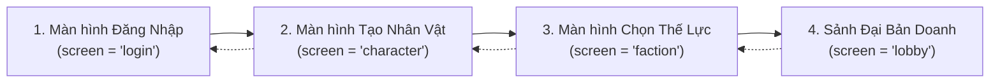

# TÀI LIỆU BÀN GIAO MÃ NGUỒN CLIENT CHO BACKEND DEVELOPER
**Dự án:** Tam Quốc Chí (Game Client Godot 4)  
**Mục đích:** Cung cấp toàn bộ cấu trúc dữ liệu, luồng màn hình, enum ID, chỉ số buff và data contract từ phía Client để đội ngũ Backend thiết kế Database, API REST và WebSocket.

---

## 1. Tổng quan Luồng Màn hình (Client State Flow)

Mã nguồn client điều hướng qua 4 trạng thái màn hình chính tại [`scripts/main.gd`](file:///d:/Hobbies/Game/ThreeKhingDom/TamQuoc_Gemini_Pro%20(2)/TamQuoc_Gemini_Pro/TamQuoc_Gemini_Pro/tam_quoc_gui/scripts/main.gd):



---

## 2. Chi tiết từng Màn hình & Dữ liệu tương tác

### 2.1. Màn hình Đăng Nhập (`login`)
- **Tập tin xử lý:** [`scripts/main.gd`](file:///d:/Hobbies/Game/ThreeKhingDom/TamQuoc_Gemini_Pro%20(2)/TamQuoc_Gemini_Pro/TamQuoc_Gemini_Pro/tam_quoc_gui/scripts/main.gd#L731-L739)
- **Phương thức đăng nhập (`method`):**
  - `"google"`: Đăng nhập liên kết tài khoản Google OAuth.
  - `"guest"`: Đăng nhập ẩn danh/khách (Client lưu UUID thiết bị cục bộ).
- **Hành động:** Khi bấm nút "VÀO GAME" (`play_button`), client gọi `_play()` chuyển sang màn hình Tạo Nhân Vật.
- **Backend cần cung cấp:**
  - `POST /api/v1/auth/login`: Nhận `method` ("google" hoặc "guest") + `token`/`device_id`, trả về `user_id`, `access_token`, và cờ `has_character: bool` (nếu đã tạo nhân vật thì nhảy thẳng vào `lobby`).

---

### 2.2. Màn hình Tạo Nhân Vật (`character`)
- **Tập tin xử lý:** [`scripts/main.gd`](file:///d:/Hobbies/Game/ThreeKhingDom/TamQuoc_Gemini_Pro%20(2)/TamQuoc_Gemini_Pro/TamQuoc_Gemini_Pro/tam_quoc_gui/scripts/main.gd#L521-L547)
- **Tên nhân vật (`player_name`):** 
  - Trường nhập `name_input.text`: Chuỗi UTF-8, tối đa 24 ký tự (`max_length = 24`), cắt khoảng trắng biên (`strip_edges()`).
- **Hệ thống Nghề nghiệp (`class_id` / `wheel_index`):**
  - `0`: **Đốc Lương** (Farmer / Nông Gia) — Trọng tâm nông nghiệp, lương thảo.
  - `1`: **Phú Thương** (Merchant / Thương Nhân) — Trọng tâm kinh tế, ngân lượng, giảm chi phí.
  - `2`: **Kỳ Tá** (Strategist / Mưu Sĩ) — Trọng tâm mưu lược, hỏa công, sương mù.
  - `3`: **Thiên Công** (Craftsman / Thợ Thủ Công) — Trọng tâm chế tạo & sửa chữa chiến cụ, công thành, rèn giáp.
  - `4`: **Trấn Quân** (Military Commander / Võ Tướng) — Trọng tâm quân sự, công thành, thiết kỵ.

- **Danh mục 9 Nhân vật hoàn chỉnh (`character_id` từ 0 đến 8):**

| ID (`character_id`) | Nghề nghiệp (`class_id`) | Giới tính (`gender`) | Tên hiển thị trong game | Asset thư mục hoạt ảnh |
|:---:|:---:|:---:|:---|:---|
| **0** | `2` (Kỳ Tá) | `male` | Kỳ Tá · Mưu Sĩ Nam | `assets/flow_idle/` |
| **1** | `2` (Kỳ Tá) | `female` | Kỳ Tá · Mưu Sĩ Nữ | `assets/female_flow_idle/` |
| **2** | `1` (Phú Thương) | `male` | Phú Thương · Thương Nhân Nam | `assets/male_merchant_idle/` |
| **3** | `1` (Phú Thương) | `female` | Phú Thương · Thương Nhân Nữ | `assets/female_merchant_idle/` |
| **4** | `4` (Trấn Quân) | `male` | Trấn Quân · Võ Tướng Nam | `assets/male_commander_idle/` |
| **5** | `4` (Trấn Quân) | `female` | Trấn Quân · Võ Tướng Nữ | `assets/female_commander_idle/` |
| **6** | `0` (Đốc Lương) | `male` | Đốc Lương · Nông Dân Nam | `assets/male_farmer_idle/` |
| **7** | `0` (Đốc Lương) | `female` | Đốc Lương · Nông Dân Nữ | `assets/female_farmer_idle/` |
| **8** | `3` (Thiên Công) | `male` | Thiên Công · Thợ Thủ Công Nam | `assets/male_craftsman_idle/` |

---

### 2.3. Bảng Chỉ Số Đặc Quyền Nghề Nghiệp (`HERO_BUFF_DATA`)
Mỗi nhân vật có 3 chỉ số nội tại (passive buffs) gắn liền, Backend cần lưu trữ để tính toán cơ chế gameplay:

```json
{
  "0": {
    "role": "Mưu Sĩ Nam",
    "buffs": {
      "fog_vision_bonus": 0.20,
      "fire_damage_bonus": 0.15,
      "fire_cooldown_reduction": 0.10,
      "tiger_tally_rate_bonus": 0.15
    }
  },
  "1": {
    "role": "Mưu Sĩ Nữ",
    "buffs": {
      "night_vision_bonus": 0.25,
      "stratagem_damage_bonus": 0.15,
      "army_grain_upkeep_discount": 0.10
    }
  },
  "2": {
    "role": "Thương Nhân Nam",
    "buffs": {
      "grain_coin_yield_bonus": 0.25,
      "economy_build_cost_discount": 0.15,
      "recruit_speed_bonus": 0.10
    }
  },
  "3": {
    "role": "Thương Nhân Nữ",
    "buffs": {
      "grain_coin_yield_bonus": 0.30,
      "siege_economic_loss_discount": 0.20,
      "cross_border_trade_value_bonus": 0.15
    }
  },
  "4": {
    "role": "Võ Tướng Nam",
    "buffs": {
      "siege_destruction_bonus": 0.20,
      "cavalry_defense_bonus": 0.15,
      "arrow_damage_reduction": 0.15,
      "army_morale_bonus": 0.15
    }
  },
  "5": {
    "role": "Võ Tướng Nữ",
    "buffs": {
      "attack_speed_bonus": 0.25,
      "evasion_bonus": 0.25,
      "armor_penetration_bonus": 0.15,
      "last_stand_team_defense_bonus": 0.15
    }
  },
  "6": {
    "role": "Nông Dân Nam",
    "buffs": {
      "global_grain_production_bonus": 0.35,
      "granary_upgrade_time_discount": 0.20,
      "army_health_satiety_regen_bonus": 0.15
    }
  },
  "7": {
    "role": "Nông Dân Nữ",
    "buffs": {
      "crop_harvest_speed_yield_bonus": 0.40,
      "long_march_supply_consumption_discount": 0.25,
      "disease_resistance_supply_regen_bonus": 0.20
    }
  },
  "8": {
    "role": "Thợ Thủ Công Nam",
    "buffs": {
      "siege_engine_craft_repair_speed_bonus": 0.25,
      "siege_damage_tower_range_bonus": 0.15,
      "equipment_upgrade_cost_durability_discount": 0.15
    }
  }
}
```

---

### 2.4. Màn hình Chọn Thế Lực (`faction`)
- **Tập tin xử lý:** [`scripts/faction_screen.gd`](file:///d:/Hobbies/Game/ThreeKhingDom/TamQuoc_Gemini_Pro%20(2)/TamQuoc_Gemini_Pro/TamQuoc_Gemini_Pro/tam_quoc_gui/scripts/faction_screen.gd)
- **Danh sách thế lực (`faction_id` / `selected_faction`):**

| `faction_id` | Tên thế lực | Mô tả vị trí | Scene sảnh tương ứng | Mã màu bảng tên người chơi |
|:---:|:---|:---|:---|:---:|
| **`0`** | **Ngụy** (Wei) | Thành đá phương Bắc | `res://scenes/lobby_wei.tscn` | `#182f40` (Xanh than) |
| **`1`** | **Thục** (Shu) | Sơn thành giữa núi | `res://scenes/lobby_shu.tscn` | `#1b302a` (Xanh thẫm) |
| **`2`** | **Ngô** (Wu) | Thủy thành ven sông | `res://scenes/lobby_wu.tscn` | `#491e16` (Đỏ nâu) |

- **Hành động:** Khi người chơi bấm nút "Xác nhận phe", client phát tín hiệu `confirmed(selected: int)` và gọi hàm `_enter_lobby(index)` trên `main.gd`.

---

### 2.5. Màn hình Sảnh Đại Bản Doanh (`lobby`)
- **Tập tin xử lý:** [`scripts/lobby_screen.gd`](file:///d:/Hobbies/Game/ThreeKhingDom/TamQuoc_Gemini_Pro%20(2)/TamQuoc_Gemini_Pro/TamQuoc_Gemini_Pro/tam_quoc_gui/scripts/lobby_screen.gd)
- **Các dữ liệu Client hiển thị cần Backend trả về:**
  1. **Thông tin định danh:**
     - `player_name`: Tên Chúa công (Client hiển thị đè lên bảng tên tại sảnh: `Rect2(151, 30, 139, 33)`).
     - `rank_title`: Quân hàm (Mặc định: `"Đô Úy"`).
     - `level`: Cấp bậc người chơi (Mặc định: `12`).
     - `avatar_id`: ID ảnh chân dung tướng.
  2. **Tài nguyên (Currencies):**
     - Bạc (`coin`): Icon 8 (Mặc định: `12.500`).
     - Kim Cương (`gem`): Icon 9 (Mặc định: `320`).
  3. **Hệ thống Menu hành động bên trái:**
     - `Nhiệm vụ` (Missions - có chấm đỏ thông báo).
     - `Thư` (Mails).
     - `Sự kiện` (Events).
  4. **Danh sách Bạn bè (`friends` panel bên phải):**
     - Mảng bạn bè: `{ friend_id, name, avatar, is_online }`.
     - Nút `Mời bạn` (Invite friend).
  5. **Hệ thống Kênh Chat (Bottom Bar):**
     - Kênh `"Thế giới"` (World Chat): hiển thị tin nhắn thời gian thực.
  6. **Thanh Điều Hướng 5 Modun Chính (Bottom Navigation):**
     - `[0] Tướng`: Quản lý thẻ bài tướng, trang bị.
     - `[1] Quân đội`: Doanh trại, phân bổ binh lính.
     - `[2] Công trình`: Quy hoạch xây dựng, nâng cấp kho lương, thành trì (`BuildingsLayer`).
     - `[3] Kho`: Quản lý lương thảo, vật phẩm.
     - `[4] Cửa hàng`: Mua bán, nạp ngọc.

---

## 3. Bản đồ Thư mục Mã Nguồn Client (`tam_quoc_gui/`)

```
tam_quoc_gui/
├── project.godot                     # File cấu hình gốc Godot 4.7
├── scripts/
│   ├── main.gd                       # Controller chính quản lý State 4 màn hình, vòng xoay, âm thanh
│   ├── faction_screen.gd             # Logic chọn phe Ngụy/Thục/Ngô
│   ├── lobby_screen.gd               # UI sảnh, bảng tên, tài nguyên, bạn bè, menu công trình
│   ├── strategist_contact_shadow.gdshader # Shader tính toán 2 tâm bóng tiếp xúc sát đế giày
│   └── gui_pointer.gd                # Con trỏ chuột phong cách Tam Quốc
├── scenes/
│   ├── lobby_wei.tscn                # Scene đại sảnh thế lực Ngụy
│   ├── lobby_shu.tscn                # Scene đại sảnh thế lực Thục
│   └── lobby_wu.tscn                 # Scene đại sảnh thế lực Ngô
├── assets/
│   ├── flow_idle/                    # Mưu sĩ nam (idle.tscn + 6 webp sheets + char_audio.ogg)
│   ├── female_flow_idle/             # Mưu sĩ nữ (idle.tscn + 6 webp sheets + char_audio.ogg)
│   ├── male_merchant_idle/           # Thương nhân nam (idle.tscn + 6 webp sheets + char_audio.ogg)
│   ├── female_merchant_idle/         # Thương nhân nữ (idle.tscn + 6 webp sheets + char_audio.ogg)
│   ├── male_commander_idle/          # Võ tướng nam (idle.tscn + 6 webp sheets + char_audio.ogg)
│   ├── female_commander_idle/        # Võ tướng nữ (idle.tscn + 6 webp sheets + char_audio.ogg)
│   ├── male_farmer_idle/             # Nông dân nam (idle.tscn + 6 webp sheets + char_audio.ogg)
│   ├── female_farmer_idle/           # Nông dân nữ (idle.tscn + 6 webp sheets + char_audio.ogg)
│   ├── merchant_bg_video/            # Video nền động Thương Nhân (144 frames loop)
│   ├── commander_bg_video/           # Video nền động Võ Tướng (192 frames loop)
│   ├── farmer_bg_video/              # Video nền động Nông Dân (96 frames loop)
│   └── char_v6/                      # Vòng xoay nghề nghiệp, nút giới tính Bagua, khung nhập tên
```

---

## 4. Đặc tả API Đề xuất cho Backend (Data Contracts)

### A. API Đăng Nhập & Tạo Phiên
- **Endpoint:** `POST /api/v1/auth/session`
- **Request:**
```json
{
  "auth_method": "guest",
  "device_id": "c4ca4238a0b923820dcc509a6f75849b",
  "google_id_token": null
}
```
- **Response:**
```json
{
  "code": 200,
  "data": {
    "user_id": 10086,
    "access_token": "eyJhbGciOiJIUzI1NiIs...",
    "has_character": false
  }
}
```

### B. API Khởi Tạo Nhân Vật & Thế Lực
- **Endpoint:** `POST /api/v1/character/create`
- **Request:**
```json
{
  "user_id": 10086,
  "player_name": "Cẩm Tú",
  "class_id": 0,
  "gender": "female",
  "character_id": 7,
  "faction_id": 0
}
```
- **Response:**
```json
{
  "code": 200,
  "message": "Character created successfully",
  "data": {
    "character_id": 7,
    "player_name": "Cẩm Tú",
    "faction": "Wei",
    "level": 1,
    "rank": "Đô Úy",
    "currencies": {
      "coin": 10000,
      "gem": 100
    },
    "passives": {
      "crop_harvest_speed_yield_bonus": 0.40,
      "long_march_supply_consumption_discount": 0.25,
      "disease_resistance_supply_regen_bonus": 0.20
    }
  }
}
```

### C. API Đồng bộ Dữ liệu Sảnh (Lobby Initialization)
- **Endpoint:** `GET /api/v1/lobby/sync`
- **Headers:** `Authorization: Bearer <access_token>`
- **Response:**
```json
{
  "code": 200,
  "data": {
    "player": {
      "name": "Cẩm Tú",
      "level": 12,
      "rank": "Đô Úy",
      "faction_id": 0,
      "character_id": 7
    },
    "resources": {
      "coin": 12500,
      "gem": 320,
      "grain": 50000
    },
    "notifications": {
      "has_unread_mail": false,
      "has_claimable_mission": true,
      "active_event_count": 2
    },
    "friends_online_count": 3
  }
}
```

---

## 5. Lệnh Kiểm Thử & Chạy Game Client
- Chạy kiểm thử tự động Headless (xác nhận toàn bộ luồng):
  ```powershell
  & "Godot_v4.7.2-stable_win64_console.exe" --headless --path "TamQuoc_Gemini_Pro/tam_quoc_gui" -- --verify
  ```
- Chạy giao diện thực tế để test UI/Gameplay:
  ```powershell
  & "Godot_v4.7.2-stable_win64_console.exe" --path "TamQuoc_Gemini_Pro/tam_quoc_gui"
  ```
